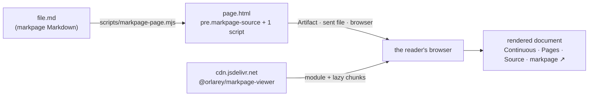

# markpage for Claude Code

A [Claude Code](https://code.claude.com) plugin to **write markpage Markdown and
see it rendered** by [markpage](https://markpage.org): math, inference rules,
abstract syntax, commutative diagrams, EBNF, charts, Mermaid, callouts,
footnotes, cross-references, named document styles and real pages.

- On **claude.ai** — Claude Code on the web or in the desktop app — Claude
  publishes the document as an **Artifact**: a private page you can keep,
  reopen and share, rendered by markpage.
- In a **terminal**, Claude opens the rendered document in your browser, where
  Print → Save as PDF gives the paged PDF.

It pairs with skills that produce markpage Markdown, such as **rewrite-rules**
(an algorithm presented as inference rules): the rules come back as a
typeset document instead of raw Markdown.

## Install

```
/plugin marketplace add orlarey/markpage
/plugin install markpage@markpage
```

or, on Claude Code 2.1.275 or later, in one step:

```
/plugin install markpage --marketplace orlarey/markpage
```

Requirements: Node 18 or later (the page script), and access to
`cdn.jsdelivr.net` from the browser that displays the page (the viewer loads
from there).

If you installed the older standalone `markpage-specs` skill (`make install`),
remove it (`make uninstall`): the plugin's **write** skill replaces it.

## Use

Two skills, which Claude also picks on its own when the request fits:

| Skill | Does |
| :-- | :-- |
| `/markpage:write [what]` | Writes a document in markpage Markdown, after reading the authoring guide (`AI-AUTHORING.md`) and the fence syntax (`SYNTAX.md`) bundled with the skill. Then shows it with `view`. |
| `/markpage:view [file.md] [--pages]` | Shows a markpage Markdown file rendered: an Artifact when Claude has the Artifact tool, an HTML page sent to you, or your browser. |

Examples:

- « Présente l'unification de `src/unify.ts` comme un système de réécriture »
  (rewrite-rules) → `docs/rules/unification.md`, then its rendered Artifact.
- « Rédige la spec du format de sauvegarde » → a markpage spec, rendered.
- `/markpage:view docs/SPEC.md --pages` → the document cut into pages.

## How it works



`scripts/markpage-page.mjs` (no dependencies) writes a page of a few kilobytes:
the Markdown, HTML-escaped, in `<pre class="markpage-source">`, and one module
script, the pinned [`@orlarey/markpage-viewer`](../viewer/) from jsDelivr. The
viewer renders the source in the reader's browser with the markpage app's own
pipeline. The page stays small and readable, which is what lets Claude publish
it as an Artifact: an Artifact's CSP admits scripts from jsDelivr and refuses
almost everything else, and Claude reads every page in full before publishing
it.

Local images: in an Artifact they are published next to the page (the script
lists them for the Artifact's `files`); in a page opened from disk they load
from the document's folder; `--inline-images` embeds them. Remote images do not
load inside an Artifact.

```sh
node claude-code/scripts/markpage-page.mjs --help
```

## Develop

```sh
claude --plugin-dir ./claude-code     # load the plugin in place; /reload-plugins after edits
claude plugin validate ./claude-code  # the plugin manifest
claude plugin validate .              # the marketplace (.claude-plugin/marketplace.json)
make claude-plugin                    # copy AI-AUTHORING.md + SYNTAX.md into skills/write/references/
```

The `write` skill carries **copies** of `AI-AUTHORING.md` and
`packages/blocks/SYNTAX.md`: an installed plugin is copied on its own, without
the rest of the repository. Edit the originals, then `make claude-plugin`; CI
fails while a copy is stale.

To try an unpublished viewer, build it (`make viewer`), serve `viewer/dist/`
and point the script at it:
`MARKPAGE_VIEWER_URL=http://127.0.0.1:8000/viewer.js node claude-code/scripts/markpage-page.mjs doc.md --open`.

## Release

1. Publish the viewer if it changed: bump `viewer/package.json`, then
   `make viewer-publish`.
2. Pin it: `VIEWER_VERSION` in `scripts/markpage-page.mjs`.
3. Bump `version` in `.claude-plugin/plugin.json` — installed copies only
   update when it changes.

Design notes: [`docs/CLAUDE-CODE-PLUGIN-SPEC.md`](../docs/CLAUDE-CODE-PLUGIN-SPEC.md).
