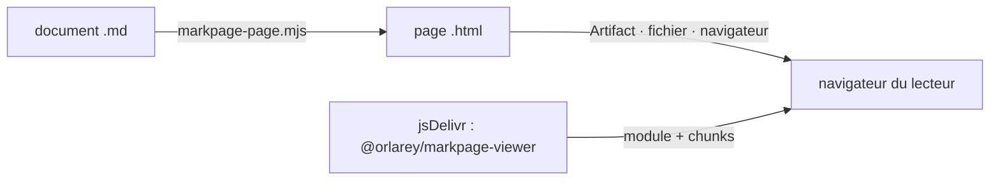

> **Statut :** livré — plugin 0.1.0, viewer `@orlarey/markpage-viewer` 0.1.0
> (à publier sur npm). Code : [`claude-code/`](../claude-code/),
> [`viewer/`](../viewer/), [`.claude-plugin/marketplace.json`](../.claude-plugin/marketplace.json).

# Scénario de référence

Dans Claude Code, l'utilisateur demande de présenter un algorithme de son dépôt comme un système de réécriture (skill *rewrite-rules*). Claude écrit `docs/rules/unification.md` en Markdown markpage : front matter, syntaxe abstraite `adt`, règles `inference`, invariants en blocs `math`. Au lieu de laisser ce Markdown brut, Claude le montre rendu : sur claude.ai, il publie un Artifact où le document apparaît comme dans markpage — feuille blanche, règles typographiées, numérotation des sections — avec un bouton Pages et un lien qui ouvre le document dans markpage.org ; dans un terminal, il ouvre la même page dans le navigateur.

# Vocabulaire

Document
: un fichier `.md` en Markdown markpage ([AI-AUTHORING.md](../AI-AUTHORING.md)).

Page
: un fichier HTML écrit par `claude-code/scripts/markpage-page.mjs` à partir d'un document : le source dans `<pre class="markpage-source">`, échappé, et un script module, le viewer.

Viewer
: `@orlarey/markpage-viewer`, module ES publié sur npm et servi par jsDelivr ; rend le source d'une page avec le pipeline de l'app (`src/document-render.ts`), comme la webview VS Code.

Artifact
: page publiée sur claude.ai par l'outil Artifact de Claude ; s'exécute sous une CSP fixe.

Affichage
: Artifact, fichier envoyé à l'utilisateur (`SendUserFile`), ou navigateur local (`--open`).

# Contraintes

La conception découle de trois contraintes externes, posées en invariants.

::: definition [CSP d'un Artifact]
Scripts : seulement `cdnjs.cloudflare.com`, `cdn.jsdelivr.net/npm/`, `unpkg.com` (et deux autres hôtes) ; feuilles de style : seulement `fonts.googleapis.com` ; polices : `fonts.gstatic.com` et `data:` ; images : `data:` et les fichiers de l'Artifact ; aucune autre requête.
:::

::: definition [Lecture avant publication]
Claude lit intégralement tout fichier qu'il publie et qu'il n'a pas écrit lui-même.
:::

::: definition [Copie du plugin]
Un plugin installé depuis la marketplace est copié seul, sans les fichiers du dépôt situés hors de son dossier ; un symlink vers ces fichiers n'est pas garanti.
:::

Conséquences :

- **I1 — page légère.** Une page ne contient que le source et une vingtaine de lignes de HTML ; le moteur de rendu n'y est jamais embarqué. Sinon la page pèserait des mégaoctets et serait illisible, donc impubliable.
- **I2 — viewer sur npm.** Le seul hôte de scripts accessible à un projet tiers est un CDN npm ; le viewer est donc un paquet npm, chargé depuis jsDelivr à une version épinglée.
- **I3 — rien d'autre que des scripts depuis le CDN.** Le CSS voyage comme texte dans le module ; ET Book et les replis Noto sont des URL `data:` ; Roboto vient de Google Fonts ; MathJax, Mermaid et Vivliostyle sont des chunks chargés par `import()`. Le viewer ne fait aucun `fetch` réseau.
- **I4 — repli lisible.** Avant l'exécution du viewer, ou s'il ne se charge pas, la page affiche le source en clair.
- **I5 — guides embarqués.** Le skill `write` contient des copies d'`AI-AUTHORING.md` et de `SYNTAX.md` ; `claude-code/sync-docs.mjs --check` (CI) garantit qu'elles sont à jour.

# Conception

## Plugin

| Élément | Rôle |
| :-- | :-- |
| `.claude-plugin/marketplace.json` | marketplace `markpage`, plugin `markpage` (source `./claude-code`) |
| `skills/write` | lit les guides embarqués, écrit le document, puis appelle `view` |
| `skills/view` | choisit l'affichage, lance le script, publie ou ouvre |
| `scripts/markpage-page.mjs` | document → page ; Node ≥ 18, sans dépendance |

Choix de l'affichage par `view` : outil Artifact présent ⇒ Artifact (`--artifact`) ; sinon outil d'envoi de fichier ⇒ page autonome (`--inline-images`) ; sinon navigateur (`--open`). Les republications d'un même document réutilisent le même chemin de page, donc la même URL d'Artifact.

## Page

En mode `--artifact`, la page est un fragment : claude.ai l'enveloppe dans son propre squelette HTML. Le source est échappé (`&` et `<`), si bien que `textContent` restitue exactement le Markdown. Les images locales ne sont pas encodées dans la page (I1) : le script les liste comme fichiers de l'Artifact, chemin publié → chemin source. Un chemin relatif propre est conservé ; tout autre chemin (`..`, absolu) est réécrit en `assets/<nom>` dans le source publié. Hors Artifact, `data-base` pointe vers le dossier du document.

## Viewer

Le viewer reprend le rendu de la webview VS Code : style nommé résolu depuis `document-style:`, `buildDocumentDom`, feuille continue ou pages Vivliostyle, zoom $r = \min(1, W_v / W_p)$, mise en page téléphone de l'app sous 601 px. Il y ajoute :

- **un relais `data:`** — Vivliostyle charge ses gabarits par `fetch('data:…')`, ce que refuse un `connect-src` restreint ; le viewer répond lui-même à ces requêtes, puisque leur contenu est dans l'URL ;
- **un lien markpage.org** — `?import=` (gzip + base64url, comme `src/share-url.ts`), affiché seulement si la charge tient sous 8 000 caractères ;
- **un thème** — le bureau et la barre suivent le thème du lecteur (`data-theme`, puis `prefers-color-scheme`) ; la feuille reste blanche, comme le papier.

# Vérification

`viewer/test/render.mjs` (CI, job *Claude Code plugin · viewer*) produit une page avec le script du plugin, la sert depuis une origine et sert `dist/` depuis une autre, sous une CSP calquée sur celle d'un Artifact (sans `eval`). Il vérifie en Chromium, en continu clair (bureau), continu sombre (téléphone) et Pages sombre : feuille ou pages produites, 7 SVG MathJax (règles d'inférence comprises), `adt`, Mermaid, image chargée, aucun défilement horizontal, aucune violation de CSP, aucune erreur console.

`claude plugin validate` valide le plugin et la marketplace ; ce n'est pas encore fait en CI, faute de CLI Claude Code dans le runner.

# Hors périmètre

Styles importés dans l'app (seuls les styles intégrés existent hors du navigateur de l'utilisateur) ; images distantes dans un Artifact (bloquées par sa CSP) ; export PDF depuis un Artifact (`window.print()` y est inopérant) ; serveur MCP dans le plugin — le pont `markpage-mcp` reste un binaire installé à part.
