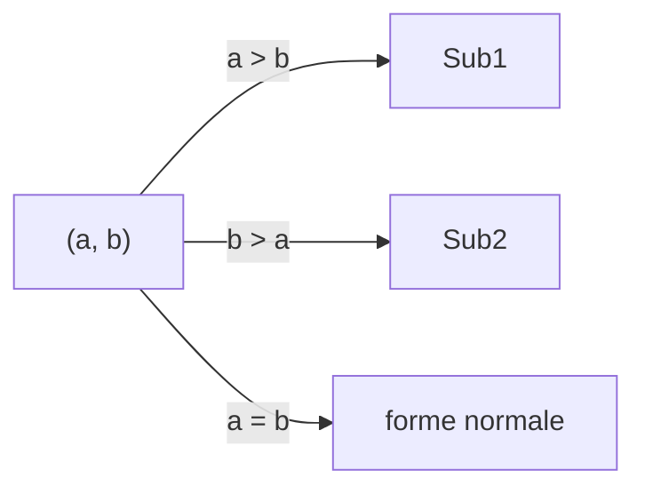

# Syntaxe abstraite

L'état est une paire d'entiers strictement positifs ; l'évaluateur d'expressions arithmétiques sert d'exemple dirigé par la syntaxe.

```adt
State ::= Pair(n, n)
Expr  ::= Num(n) | Op(o, Expr, Expr) | If(Expr, Expr, Expr)
```

# Règles

```inference (Sub1)
a > b
---
(a, b) → (a − b, b)
```

```inference (Sub2)
b > a
---
(a, b) → (a, b − a)
```

```inference (EOp)
---
E⟦Op(o, e1, e2)⟧ρ = apply(o, E⟦e1⟧ρ, E⟦e2⟧ρ)
```

```inference (EIf)
E⟦e1⟧ρ = true
---
E⟦If(e1, e2, e3)⟧ρ = E⟦e2⟧ρ
```

# Invariant et terminaison

::: proposition [Invariant]
Chaque règle préserve $\gcd(a, b)$.
:::

::: proof
Si $a > b$, tout diviseur commun de $a$ et $b$ divise $a - b$, et réciproquement.
:::

La mesure $\mu(a, b) = a + b$ décroît strictement :

$$
\mu(a - b, b) = a < a + b = \mu(a, b)
$$

# Contrôle



| Règle | Code |
| :---- | :--- |
| `Sub1` | `gcd.c:12` |
| `Sub2` | `gcd.c:14` |


